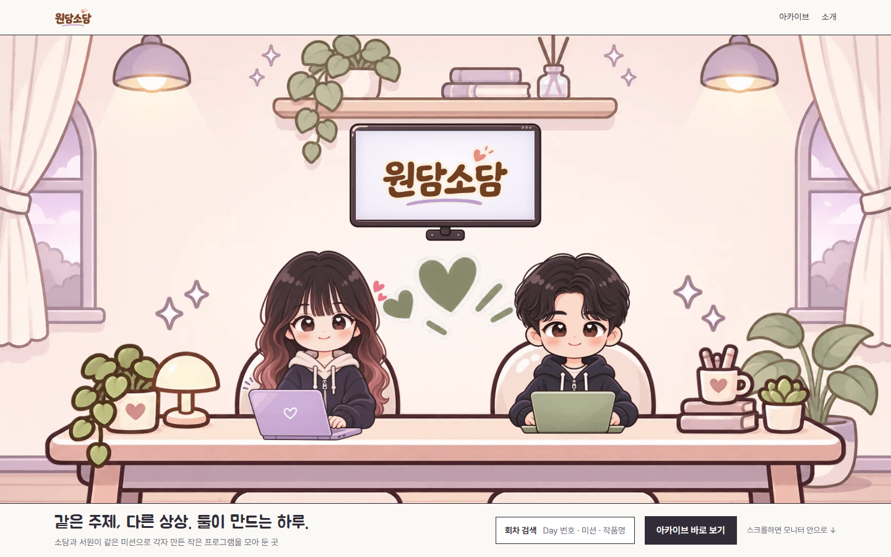

# 원담소담 아카이브

> **같은 주제, 다른 상상. 둘이 만드는 하루.**

소담과 서원이 매일 같은 미션을 정해 각자 만든 작은 프로그램을 회차(Day)별로 모아 둔 곳이에요.

### 👉 [wondam-sodam.github.io/archive](https://wondam-sodam.github.io/archive/)

> 지금 올라와 있는 Day 1~7은 화면을 미리 보여 주는 샘플이에요. 실제 회차는 곧 채워질 예정이에요.

---

## 둘러보기

### 작업실
처음 들어오면 소담과 서원이 나란히 앉아 있는 작업실이 보여요. 아래로 스크롤하면 모니터 속으로 들어가 회차 검색 화면으로 이어져요.
바로 회차를 보고 싶다면 **아카이브 바로 보기** 버튼을 누르면 돼요.

### 회차 찾기
- 검색창에 **Day 번호**(`7`, `DAY 7`), **미션**, **작품명**, **날짜**를 입력해 찾을 수 있어요.
- **PC**: 왼쪽 목록에서 Day를 고르면 오른쪽에 그날의 미션과 두 사람의 작품이 나란히 보여요.
- **모바일**: 검색하거나 **최근 회차** · **전체 보기**를 누르면 목록이 펼쳐져요.

### 작품 체험하기
작품 썸네일을 누르면 바로 체험할 수 있어요. 썸네일 오른쪽 위에 `WEB` · `MOBILE APP` · `DESKTOP APP` 같은 작품 종류가 표시돼요.

- 휴대폰용 작품을 PC에서 누르면 **QR 코드**가 나와요. 휴대폰 카메라로 찍으면 바로 열려요.
- PC용 작품을 휴대폰에서 누르면 링크를 복사해 두었다가 PC에서 열 수 있어요.
- 아직 체험할 수 없는 작품은 그렇다고 알려 줘요.

### 회차 자세히 보기
회차를 열면 그날의 미션, 두 작품의 소개와 사용법, 관련 링크, 그날의 릴스를 볼 수 있어요. 아래쪽에서 이전 · 다음 회차로 넘어갈 수 있어요.

### 소개
페이지 맨 아래에서 원담소담 이야기와 인스타그램 계정을 볼 수 있어요.

---

## 인스타그램

| 계정 | 주소 |
|---|---|
| 원담소담 | [@wondam_sodam.log](https://www.instagram.com/wondam_sodam.log/) |
| 소담 | [@sodam.wd](https://www.instagram.com/sodam.wd/) |
| 서원 | [@seowon.wd](https://www.instagram.com/seowon.wd/) |

---

## 이용 안내
- PC와 휴대폰 모두에서 볼 수 있어요.
- 움직임 줄이기 설정을 켜 두었다면 작업실 장면이 움직이지 않고 그림으로만 보여요.
- 소담 · 서원 캐릭터와 사이트의 그림은 원담소담의 창작물이에요. 무단으로 사용하지 말아 주세요.
